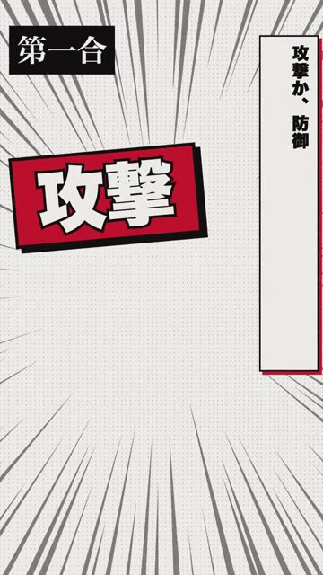

# AIワードバトル

**自由な言葉を技に変える、AI判定型の対戦ゲームのPoC（概念実証）。**

プレイヤーはターンごとに「攻撃」か「防御」を選び、25文字以内で自由に技名を入力します。技名の意味からAIが属性・威力・独創性を推定し、攻撃と防御の意味的な噛み合わせが勝敗に影響します。対戦は2人用で、観戦とAIなしの演出デモも用意しています。



[紹介動画を見る](public/promo.mp4)

## このPoCで検証したいこと

- 固定された技一覧を使わず、プレイヤー自身の発想を戦闘にできるか
- 単純な単語一致ではなく、技の意味と相手の防御の関連性を駆け引きに使えるか
- 威力の高そうな言葉の連発や相手の技の模倣に対して、意味ベースの補正を設けられるか

## 仕組み

- **フロントエンド:** Preact / Vite
- **対戦処理:** Cloudflare Workers / Durable Objects / WebSocket
- **技の判定:** Workers AIの埋め込みモデル（PLaMo）を利用。属性・強さ・独創性・意味的な関連性から数値化
- **実況:** Workers AIのGemmaによる短い実況文
- **利用制限:** Workers AIの呼び出し量を見積もって制限する仕組みを実装

判定ロジックは `src/worker/`、対戦プロトコルは `src/shared/protocol.ts` を参照してください。

## 開発

Node.js 24.22.1以上を想定しています。Workers AIの利用にはCloudflare側の環境設定が必要です。

```sh
npm ci
npm run dev
npm run typecheck
npm run build
```

Cloudflareへのデプロイ設定は `wrangler.jsonc` にあります。デモ画面は `/demo` からアクセスできます。

## 制限・注意事項

**これは実験的なゲーム性検証用PoCであり、運用・セキュリティを保証する製品版ではありません。** 現在の4桁ルームコードやクライアント側のプレイヤー識別は、本格的な公開サービスや競技用途向けの認証・不正対策を備えていません。Workers AIの利用上限により判定や実況が利用できなくなる場合もあります。

紹介動画（`public/promo.mp4`）は配布済みのプレビュー用成果物です。制作ソースは `promo/` にあります。

## ライセンス

ソースコードは **[PolyForm Noncommercial License 1.0.0](LICENSE.md)** に基づき、非商用目的に限って利用・変更・再配布できます。商用利用には権利者から別途許可を得てください。これはOSI認定のオープンソースライセンスではありません。

紹介動画・ポスターなどのメディア成果物は上記ソースコードのライセンスの対象外です。動画内のVOICEVOX音声は各キャラクター・音声ライブラリの利用規約にも従います（クレジット：VOICEVOX:青山龍星 / VOICEVOX:ずんだもん）。画像・映像・音声の再利用に関して、PolyFormの許諾が及ぶものとは扱わないでください。

なお、**ゲームの発想そのものに対する独占権を主張するものではありません**。
